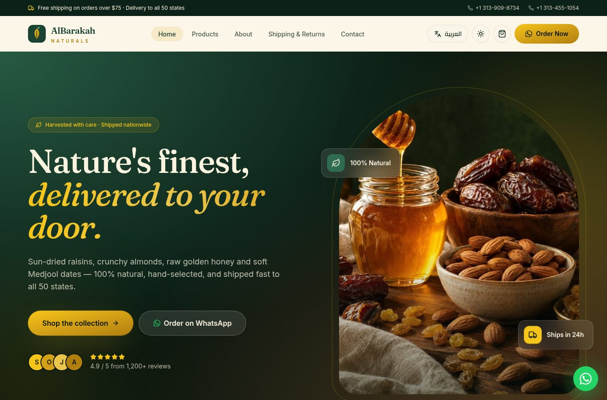
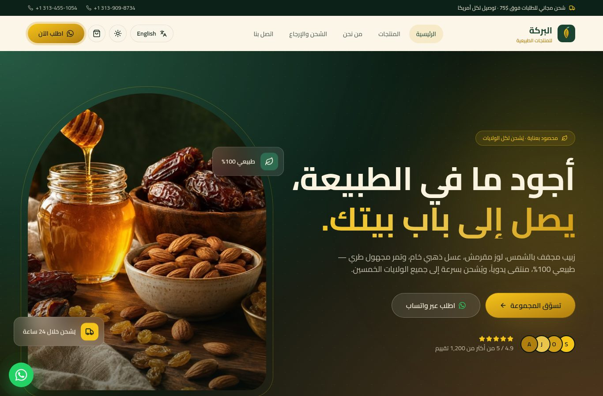
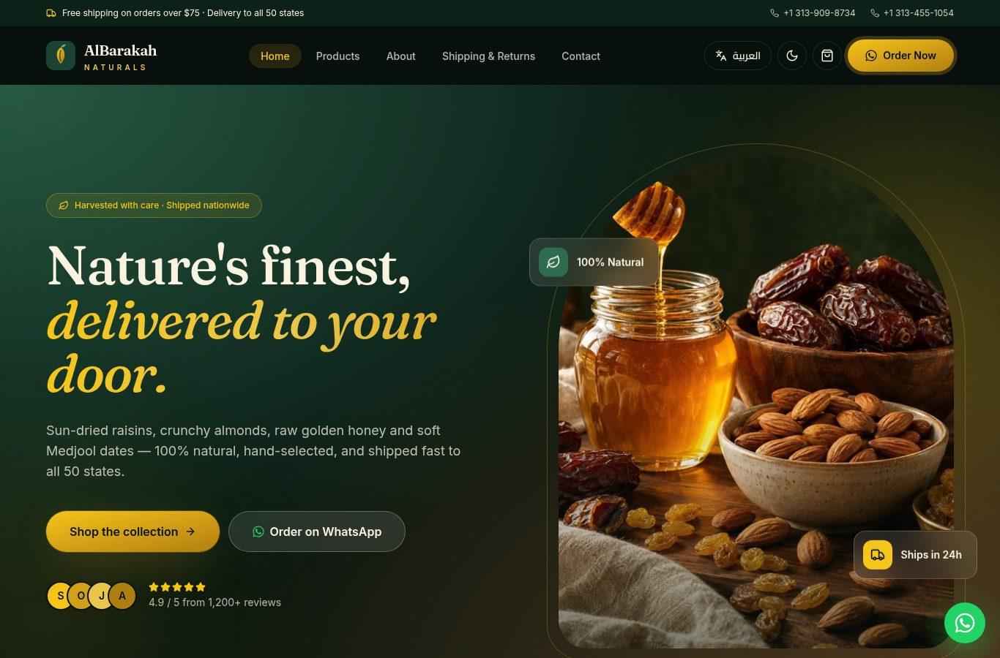
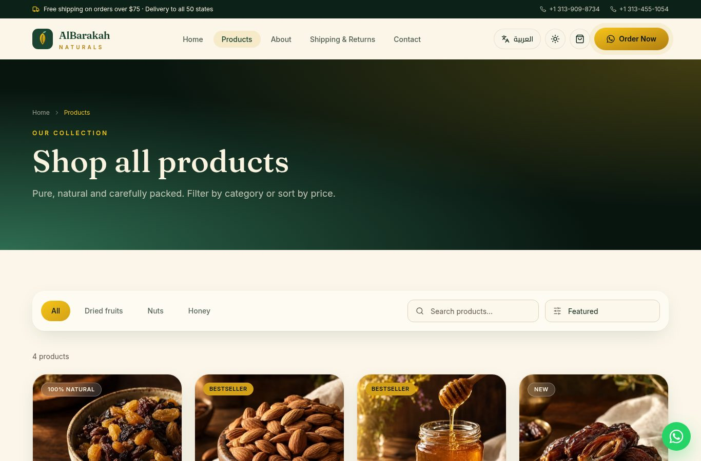
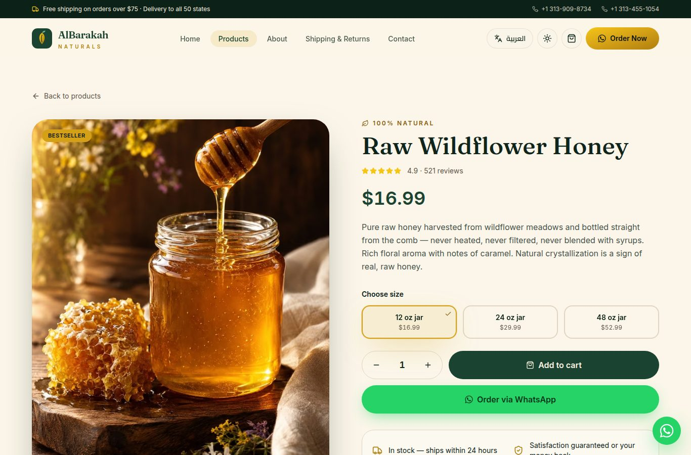
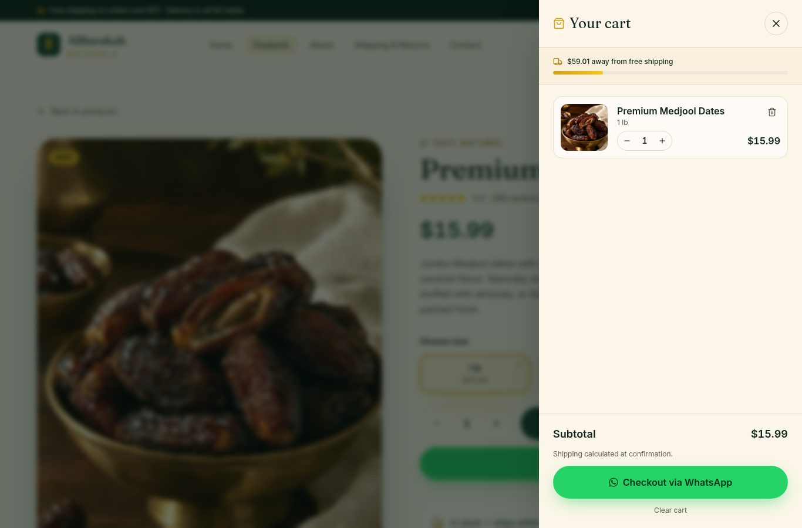
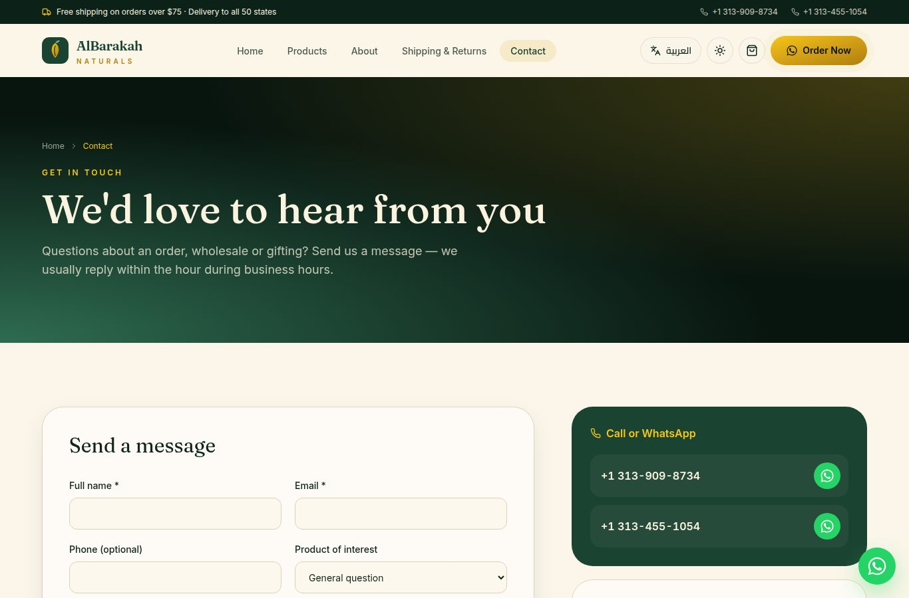
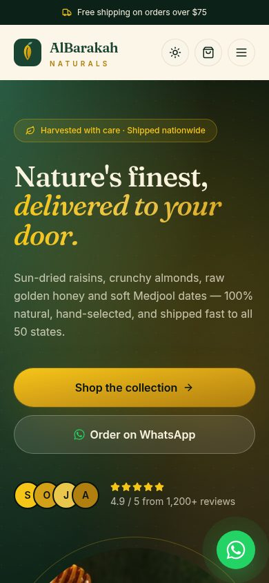

# AlBarakah Naturals — البركة للمنتجات الطبيعية

> **100% Natural Products — Delivered to Your Door Across America**
> **منتجات طبيعية 100% — توصيل لباب بيتك في كل أمريكا**

A production-ready, bilingual (English / العربية RTL) e-commerce storefront for premium raisins, almonds, raw honey and Medjool dates — built with **Next.js 14 (App Router) + TypeScript + Tailwind CSS + shadcn/ui + Framer Motion**.

[English](#-english) · [العربية](#-العربية)



---

## 🇺🇸 English

### ✨ Features

- **Next.js 14 App Router** + TypeScript (strict), zero TS / ESLint errors.
- **Bilingual EN / AR** with a one-click toggle — full RTL layout, Cairo font for Arabic, choice saved in the browser.
- **Dark mode** (system-aware, persisted) via `next-themes`.
- **Pages:** Home, Products (category tabs + search + sort), Product details (`/products/[slug]` with weight options & quantity), About, Contact (validated form → WhatsApp or e-mail), Shipping & Returns, custom 404.
- **Cart drawer** with quantities, free-shipping progress bar and **checkout via WhatsApp** (the full order is pre-written in the message).
- **WhatsApp everywhere:** floating button, per-product “Order on WhatsApp” with the product name, size and quantity.
- **Design:** honey / gold / forest-green / cream palette, glassmorphism header, cinematic parallax hero, scroll-reveal animations, 3D tilt product cards, animated counters (5000+ customers), shimmer skeletons while images load, micro-interactions.
- **SEO:** per-page metadata, Open Graph & Twitter cards, `sitemap.xml`, `robots.txt`, web manifest, Schema.org JSON-LD (**Organization, LocalBusiness, Product, FAQPage**).
- **Performance & a11y:** fully static pages (SSG), `next/image`, `next/font`, skip link, ARIA labels, keyboard focus states, `prefers-reduced-motion` support, semantic HTML.
- **Single source of truth:** all texts in `data/site.ts`, all products in `data/products.ts`.

### 🚀 Quick start

Requirements: **Node.js 18.17+** (Node 20 LTS recommended).

```bash
npm install && npm run dev
```

Open <http://localhost:3000>.

| Command | What it does |
|---|---|
| `npm run dev` | Development server with hot reload |
| `npm run build` | Production build |
| `npm run start` | Serve the production build |
| `npm run lint` | ESLint |
| `npm run type-check` | TypeScript check |
| `npm run export` | Fully static export to `out/` (for any static host: Netlify, Cloudflare Pages, cPanel…) |

> On Windows CMD, use `set NEXT_OUTPUT=export&& next build` instead of `npm run export`, or simply deploy to Vercel.

### ☁️ Deploy to Vercel (step by step)

1. Create a free account at <https://vercel.com> (sign in with GitHub).
2. Push this folder to a new GitHub repository:
   ```bash
   git init
   git add .
   git commit -m "AlBarakah Naturals"
   git branch -M main
   git remote add origin https://github.com/<your-user>/albarakah-naturals.git
   git push -u origin main
   ```
3. Go to <https://vercel.com/new> → **Import** the repository.
4. Framework preset is detected automatically (**Next.js**). Keep the defaults.
5. Under **Environment Variables** add:
   `NEXT_PUBLIC_SITE_URL` = `https://your-domain.com` (used for SEO, sitemap and OG links).
6. Click **Deploy**. In ~1 minute your store is live.
7. (Optional) **Settings → Domains** → add your custom domain and follow the DNS instructions.

Every `git push` afterwards redeploys automatically.

### ✏️ Editing content (no coding needed)

#### Store info, phones, WhatsApp → `data/site.ts`

```ts
export const siteConfig = {
  name: "AlBarakah Naturals",          // store name (whole site)
  phones: [
    { display: "+1 313-909-8734", tel: "+13139098734" },
    { display: "+1 313-455-1054", tel: "+13134551054" },
  ],
  whatsapp: "13139098734",             // digits only, with country code
  email: "hello@albarakahnaturals.com",
  freeShippingThreshold: 75,           // USD
  // social links, working hours, stats…
};
```

All visible texts (menus, hero, FAQ, testimonials, footer, form labels…) live in the `dictionaries` object in the same file — `en` and `ar` side by side.

#### Products & prices → `data/products.ts`

Each product has a `slug`, bilingual `name` / `description`, `image`, `category` and a list of `sizes`:

```ts
sizes: [
  { label: "1 lb", price: 12.99 },
  { label: "2 lb", price: 22.99, compareAt: 25.98 },
  { label: "5 lb", price: 49.99 },
],
```

- Change a price → edit `price`.
- Add a product → copy an existing object, give it a new unique `slug` and image. Its page `/products/<slug>` is generated automatically.

#### Images → `public/images/`

Replace `hero.jpg`, `raisins.jpg`, `almonds.jpg`, `honey.jpg`, `dates.jpg`, `about.jpg` with your own photos (same file names, portrait ratio ≈ 2:3 recommended). Replace `public/og-image.jpg` (1200×630) for social sharing. Logo: `public/logo.svg`, `public/logo-mark.svg`, `public/favicon.svg`.

#### Environment variables → `.env.example`

Copy to `.env.local` and adjust (all optional — the site works without it).

> ⚠️ **Sample content to replace before launch:** testimonials, statistics, the e-mail address, social links and the business region (Michigan) are placeholders. Product photos are AI-generated illustrations.

### 📁 Project structure

```
app/                     routes (App Router)
  page.tsx               home
  products/              catalog + [slug] details
  about/ contact/ shipping-returns/
  not-found.tsx          custom 404
  sitemap.ts robots.ts manifest.ts
components/
  ui/                    shadcn-style primitives (button, accordion, input, skeleton…)
  layout/                header, footer, cart drawer, toggles, WhatsApp button
  sections/              hero, features, products, why-us, testimonials, FAQ, CTA…
  seo/                   JSON-LD schemas
data/
  site.ts                ⭐ store settings + all EN/AR texts
  products.ts            ⭐ products, prices, sizes
lib/                     i18n, cart, WhatsApp, SEO helpers
public/                  logo, favicon, images, OG image
docs/screenshots/        preview images
```

### 📸 Screenshots

| | |
|---|---|
|  Home |  Arabic (RTL) |
|  Dark mode |  Products |
|  Product page |  Cart drawer |
|  Contact |  Mobile |

---

## 🇸🇦 العربية

<div dir="rtl">

### ✨ المميزات

- **Next.js 14 (App Router)** مع TypeScript — بدون أي أخطاء TypeScript أو ESLint.
- **ثنائي اللغة (إنجليزي / عربي)** بزر واحد، مع اتجاه RTL كامل وخط Cairo للعربية، ويُحفَظ اختيار الزائر.
- **الوضع الداكن** تلقائي حسب الجهاز مع إمكانية التبديل.
- **الصفحات:** الرئيسية، المنتجات (تصفية بالفئة + بحث + ترتيب)، صفحة كل منتج مع خيارات الوزن والكمية، من نحن، تواصل معنا (نموذج مع تحقق يرسل عبر واتساب أو البريد)، الشحن والإرجاع، صفحة 404 مخصصة.
- **سلة مشتريات** مع شريط تقدّم الشحن المجاني و**إتمام الطلب عبر واتساب** برسالة جاهزة بكل التفاصيل.
- **واتساب في كل مكان:** زر عائم، وزر «اطلب عبر واتساب» لكل منتج يتضمن اسم المنتج والحجم والكمية.
- **تصميم فاخر:** ألوان العسل والذهبي والأخضر الغامق والبيج، هيدر زجاجي، واجهة سينمائية بتأثير Parallax، حركات عند التمرير، بطاقات ثلاثية الأبعاد، عدّادات متحركة، Skeleton أثناء تحميل الصور.
- **SEO كامل:** Metadata لكل صفحة، Open Graph وTwitter، خريطة الموقع، robots، و Schema.org (Organization وLocalBusiness وProduct وFAQPage).
- **أداء وإتاحة:** صفحات ثابتة بالكامل، `next/image` و`next/font`، دعم لوحة المفاتيح وقارئات الشاشة، واحترام إعداد تقليل الحركة.

### 🚀 التشغيل

المتطلبات: **Node.js 18.17 أو أحدث** (يُفضّل 20 LTS).

```bash
npm install && npm run dev
```

ثم افتح <http://localhost:3000>.

- `npm run build` ثم `npm run start` — نسخة الإنتاج.
- `npm run export` — تصدير ثابت كامل إلى مجلد `out/` لرفعه على أي استضافة (Netlify، Cloudflare Pages، cPanel…).

### ☁️ النشر على Vercel خطوة بخطوة

1. أنشئ حساباً مجانياً على <https://vercel.com> (سجّل الدخول بحساب GitHub).
2. ارفع المشروع إلى مستودع GitHub جديد (الأوامر موجودة في القسم الإنجليزي أعلاه).
3. افتح <https://vercel.com/new> واضغط **Import** على المستودع.
4. سيتعرّف Vercel تلقائياً على **Next.js** — اترك الإعدادات كما هي.
5. في **Environment Variables** أضف: `NEXT_PUBLIC_SITE_URL` = رابط موقعك (مثل `https://your-domain.com`).
6. اضغط **Deploy** — خلال دقيقة تقريباً يصبح المتجر منشوراً.
7. (اختياري) من **Settings ← Domains** أضف نطاقك الخاص واتبع تعليمات DNS.

بعدها كل `git push` يعيد النشر تلقائياً.

### ✏️ تعديل المحتوى من ملف واحد

- **اسم المتجر، أرقام الهاتف، رقم واتساب، البريد، ساعات العمل، روابط السوشيال، حد الشحن المجاني:** في `data/site.ts` داخل `siteConfig`.
  رقم واتساب يُكتب أرقاماً فقط مع رمز الدولة، مثل `13139098734`.
- **جميع نصوص الموقع** (القوائم، الواجهة، الأسئلة الشائعة، آراء العملاء، الفوتر…) في نفس الملف داخل `dictionaries` — الإنجليزي `en` والعربي `ar`.
- **المنتجات والأسعار والأحجام:** في `data/products.ts`. لتغيير السعر عدّل `price`، ولإضافة منتج انسخ منتجاً موجوداً وغيّر `slug` (يجب أن يكون فريداً) والصورة — تُنشأ صفحته تلقائياً.
- **الصور:** استبدل الملفات في `public/images/` بنفس الأسماء (يُفضّل نسبة طولية 2:3)، وصورة المشاركة `public/og-image.jpg` بمقاس 1200×630، والشعار في `public/logo.svg`.

> ⚠️ **قبل الإطلاق:** آراء العملاء، الإحصائيات، البريد الإلكتروني، روابط السوشيال ومنطقة النشاط (ميشيغان) هي بيانات تجريبية يجب استبدالها. صور المنتجات مولّدة بالذكاء الاصطناعي ويُنصح باستبدالها بصور حقيقية.

### 📸 لقطات الشاشة

راجع جدول الصور في القسم الإنجليزي أعلاه، أو مجلد `docs/screenshots/`.

### 📄 الترخيص

MIT — راجع ملف `LICENSE`.

</div>

---

**License:** MIT — see [LICENSE](LICENSE).
